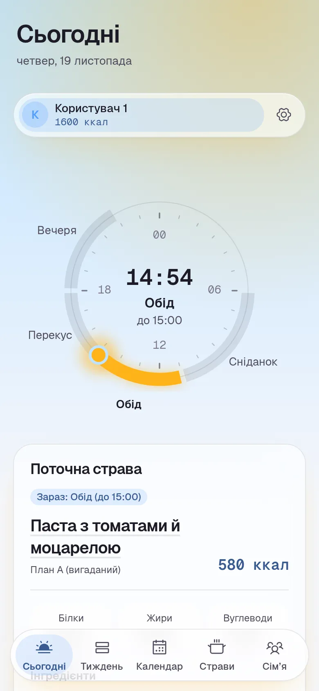
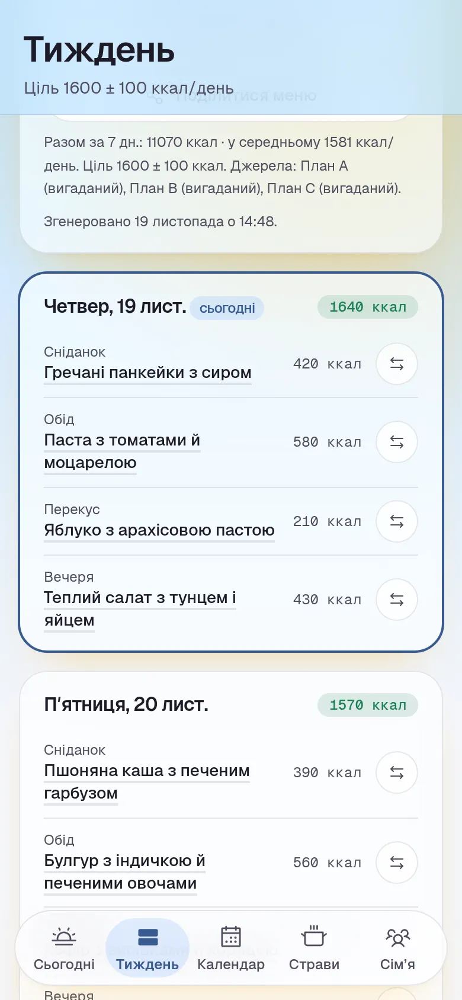
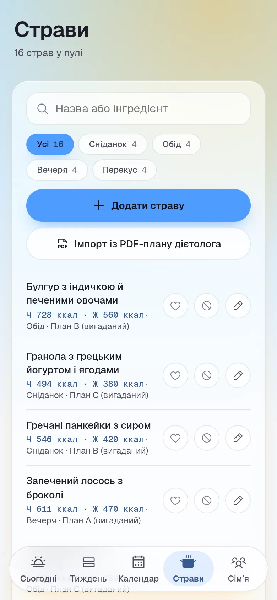
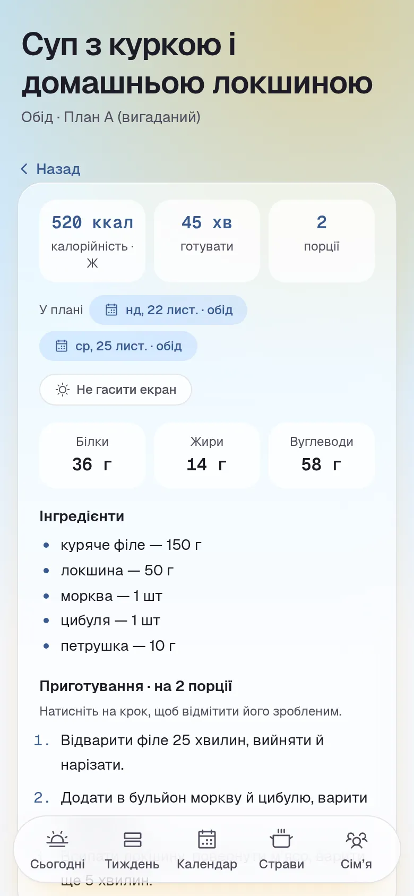
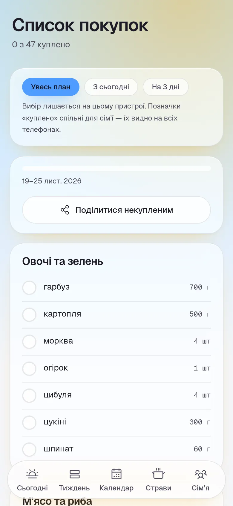
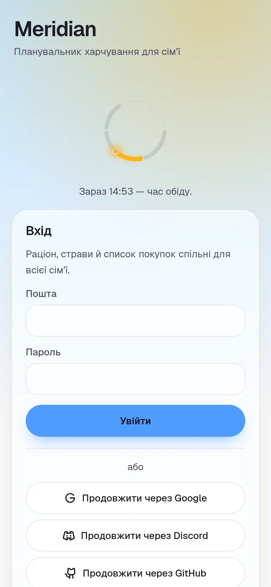
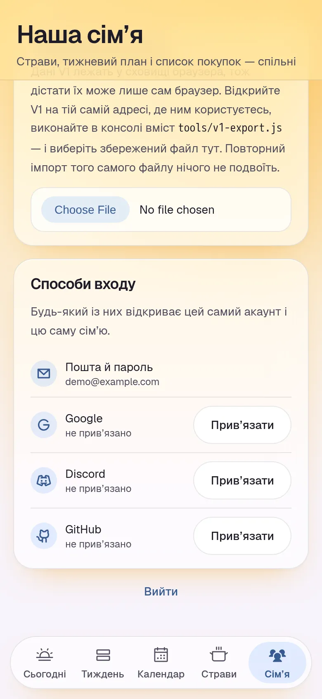

<div align="center">

# Meridian

**A family meal planner that assembles your week from your dietitian's plans.**

[](https://github.com/1h8sn0w/meridian/actions/workflows/ci.yml)




[Українською](README.md)

</div>

---

A dietitian hands you several meal plans as PDFs. Meridian splits them into individual meals and assembles a new week on its own: it keeps the plan's calories and structure but mixes meals across several plans, so the rotation doesn't get stale. The home screen answers one question: what to eat right now.

For families who eat by a dietitian's plan and want variety without counting. The app never invents food: every meal comes from a plan, a PDF import or your own manual entry.

## Features

- **A week in one tap.** The generator picks a meal for every slot so the day stays inside the profile's target corridor (±100 kcal by default), meals don't repeat more often than the anti-repeat rule allows, and the week draws on several plans.
- **Today.** A day clock with meal windows, the current meal with macros and ingredients, reminders before each meal. The calendar shows the plan and macros for any day.
- **Meals and recipes.** A shared meal pool: search, "Favourite" and "Disliked", manual entry, import from a PDF plan, a starter set provided by the server admin.
- **Shopping list** for the week, grouped by store section; "bought" marks are shared across the family.
- **Family.** Shared plan, pool and shopping; each profile has its own calorie target and portion; new members join with an invite code.
- **Local-first PWA.** Installs from the browser, works offline and syncs the family's devices.
- **Interface** in Ukrainian, English, Polish and German. **Sign-in** with email and password or with Google, Discord, GitHub.

<div align="center">






Screenshots come from a test account with made-up meals; the UI is shown in Ukrainian.

</div>

## Where to try it

For now Meridian is self-hosted: your own server comes up with one command (below). A hosted version will follow; its address is **TODO: the domain hasn't been bought yet**.

## Self-host

### Requirements

- Docker with the Compose plugin (`docker compose`, not the old `docker-compose`). Tested on Docker 27 and Compose 5.6.
- Memory: idle, the stack takes about 0.5 GB of RAM, more under sync load; plan for 1–2 GB. Disk: a few GB for images (Postgres alone is 1.2 GB).
- Free ports 80 and 443, or your own via `HTTP_PORT`/`HTTPS_PORT`.
- HTTPS for any address other than `localhost`: without a secure context the browser won't let the app open its local database. For internet access, a domain pointing at this host.

### First run

```sh
git clone https://github.com/1h8sn0w/meridian.git
cd meridian
docker compose up -d
```

The first run takes a few minutes while the app image builds. The stack generates its own secrets (Postgres password, `JWT_SECRET`, anon key), keeps them in its own volume and applies the database schema itself. In `docker compose ps -a`, `init` and `migrate` show `Exited (0)` — that's expected.

Then open <http://localhost>, sign up, create a family and a profile, add meals (by hand, from a PDF or the starter set) and press "Generate the week" on the Week screen.

### Environment variables

You only need `.env` to change something: `cp .env.example .env`. After a change, run `docker compose up -d`. The stack's secrets never go into `.env`; it only holds OAuth keys if you turn on provider sign-in.

| Variable | Default | What it does |
|----------|---------|--------------|
| `APP_URL` | `http://localhost` | The app's address. `https://` with a domain turns on a Let's Encrypt certificate |
| `HTTP_PORT`, `HTTPS_PORT` | `80`, `443` | Host ports; the port in `APP_URL` must match one of them |
| `GOTRUE_DISABLE_SIGNUP` | `false` | `true` closes sign-up (see "Security") |
| `GOTRUE_MAILER_AUTOCONFIRM` | `true` | The stack has no email, so accounts are confirmed immediately |
| `GOTRUE_EXTERNAL_<PROVIDER>_*` | off | Sign-in with Google, Discord, GitHub (below) |
| `STARTER_SET_FILE` | empty | Starter meal set JSON, kept outside the repository |
| `WEB_IMAGE` | empty | A prebuilt app image instead of a local build; only works with the overlay: `docker compose -f compose.yaml -f infra/compose.prebuilt.yaml up -d` |

A home server without a domain (`https://<IP>:<port>` and the local certificate authority), the starter set and the prebuilt image are covered in [`infra/README.md`](infra/README.md) (in Ukrainian).

### Updating

Back up first (below), then:

```sh
git pull
docker compose up -d --build
```

`--build` rebuilds the app image from the new sources: without it Compose keeps the old one. `migrate` applies new database migrations on its own. With a prebuilt image, pull the new one instead of `--build`: `docker compose -f compose.yaml -f infra/compose.prebuilt.yaml pull caddy`, then `up -d` with the same `-f` flags.

### Backup and restore

Everything worth keeping lives in Docker volumes: `db-data` (the database), `secrets` (passwords and keys — without them the backed-up database won't open), `db-config` and `caddy-data` (certificates). A backup is an archive of these volumes taken with the stack stopped. The commands run from the repository folder, and the archive lands next to it so it can't end up in git by accident:

```sh
VOLS="-v meridian_secrets:/v/secrets -v meridian_db-data:/v/db-data -v meridian_db-config:/v/db-config -v meridian_caddy-data:/v/caddy-data"
docker compose stop
docker run --rm $VOLS -v "$PWD/..":/backup alpine sh -c 'umask 077 && tar czf /backup/meridian-backup.tgz -C /v .'
docker compose up -d
```

Restore on a clean host (a clone of the repository, the same `.env` and the `STARTER_SET_FILE` file, if set) or after `docker compose down -v`:

```sh
VOLS="-v meridian_secrets:/v/secrets -v meridian_db-data:/v/db-data -v meridian_db-config:/v/db-config -v meridian_caddy-data:/v/caddy-data"
docker compose create
docker run --rm $VOLS -v "$PWD/..":/backup alpine tar xzf /backup/meridian-backup.tgz -C /v
docker compose up -d
```

The archive contains the stack's secrets, so keep it as safe as your passwords. The `meridian_` prefix is the project name from `compose.yaml`; if you run with `-p` or `COMPOSE_PROJECT_NAME`, use yours. With a prebuilt image, run `create` and `up -d` with the same `-f` flags as for updating.

## Sign-in with Google, Discord and GitHub

Off by default: the sign-in screen shows only email and password. Each installation registers its own OAuth app with the provider:

| Provider | Where to create it | Where the callback URL goes |
|----------|--------------------|-----------------------------|
| Google | Google Cloud Console → APIs & Services → Credentials → Create credentials → OAuth client ID, type "Web application" | Authorized redirect URIs |
| Discord | Developer Portal → Applications → New Application → OAuth2 | Redirects |
| GitHub | Settings → Developer settings → OAuth Apps → New OAuth App | Authorization callback URL |

The callback URL is `APP_URL` + `/auth/v1/callback`, e.g. `https://meridian.example.com/auth/v1/callback`. Google doesn't accept an IP address, so it needs a domain. Then in `.env` (the same for `GOOGLE` and `DISCORD`):

```
GOTRUE_EXTERNAL_GITHUB_ENABLED=true
GOTRUE_EXTERNAL_GITHUB_CLIENT_ID=<Client ID>
GOTRUE_EXTERNAL_GITHUB_SECRET=<Client secret>
```

and `docker compose up -d auth`. The "Continue with …" button appears on the sign-in screen by itself.

**Linking to an existing account.** Family → Sign-in methods → Link: from then on any linked method opens the same account and the same family. There is deliberately no automatic linking by email, so a first sign-in through a provider without linking creates a **new** account, even with the same email. Sign in the usual way first, then link the provider. Everything can be unlinked except email and the last sign-in method. Conflicts and details are in [`.env.example`](.env.example).

<div align="center">




</div>

## Security

**Found a vulnerability?** Please don't open a public issue. Report it privately on GitHub: the **Security** tab → **Report a vulnerability**.

For your own server:

- **Close sign-up** as soon as the whole family has accounts: `GOTRUE_DISABLE_SIGNUP=true` in `.env` and `docker compose up -d auth`. Otherwise anyone who knows the address can sign up. How to check it and how to add a family member later — [`infra/README.md`](infra/README.md).
- **Rate-limit requests** to `/auth/v1/` if there is a proxy or tunnel in front of the stack (rate limiting rules), to make password guessing harder.
- Only Caddy is published: don't expose the Postgres port.
- Update regularly, and keep backup archives encrypted: they contain the stack's keys.

## How it works

The UI reads and writes SQLite on the device, so no action waits for the network. PowerSync syncs it with Postgres in the background, and writes go through PostgREST (row-level last-write-wins). The server is a subset of self-hosted Supabase (Postgres, GoTrue, PostgREST) behind Caddy in a single `compose.yaml`; there is no separate app server. The frontend is a static SPA on Vite and TanStack Router. The week generator is plain TypeScript in [`packages/core`](packages/core): a constraint problem solved greedily with randomness and bounded backtracking, no ML.

## Development

```sh
pnpm install
pnpm dev        # apps/web on http://localhost:3000, next to a running stack
pnpm lint && pnpm typecheck && pnpm test && pnpm format:check && pnpm build
```

`pnpm dev` uses the database, sign-in and sync of the stack running next to it, so it first needs `apps/web/.env` — the command that builds it is in [`infra/README.md`](infra/README.md#розробка-застосунку).

## Documentation

Each folder explains its decisions in its own `README.md` (in Ukrainian): [`infra`](infra/README.md) — self-hosting and secrets ([`DECISIONS.md`](infra/DECISIONS.md) — stack decisions), [`packages/core`](packages/core/README.md) — the generator and the starter set format, [`packages/db`](packages/db/README.md) — tables and RLS, [`apps/web`](apps/web/README.md) — the app and PWA, [`tools`](tools/README.md) — migrating data from V1. Terms are in [`GLOSSARY.md`](GLOSSARY.md), the map for AI agents in [`AGENTS.md`](AGENTS.md). Tasks and architecture decisions live in Linear.

## License

[MIT](LICENSE) © 2026 Volodymyr Chornous
