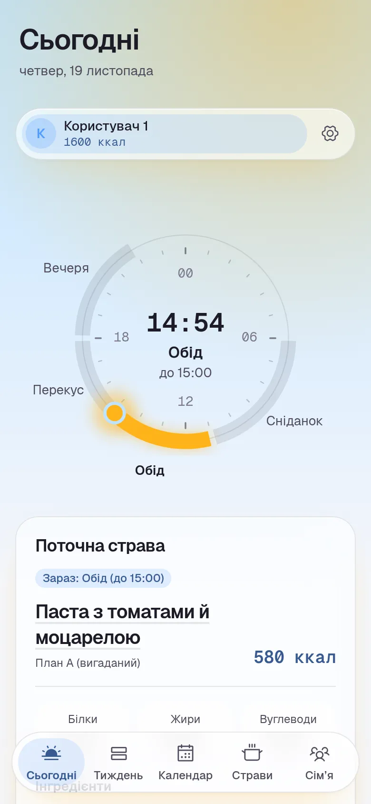
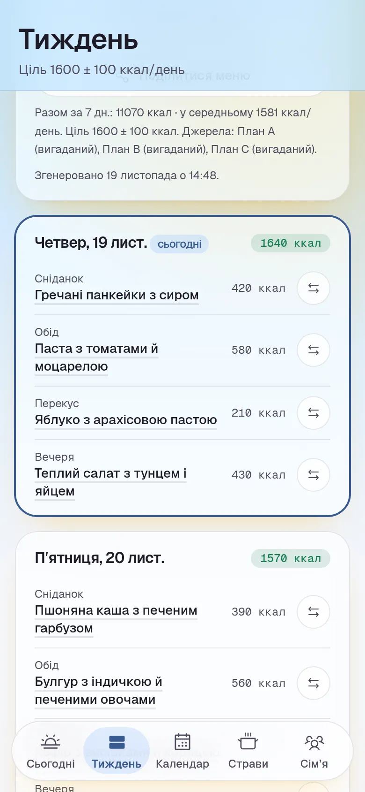
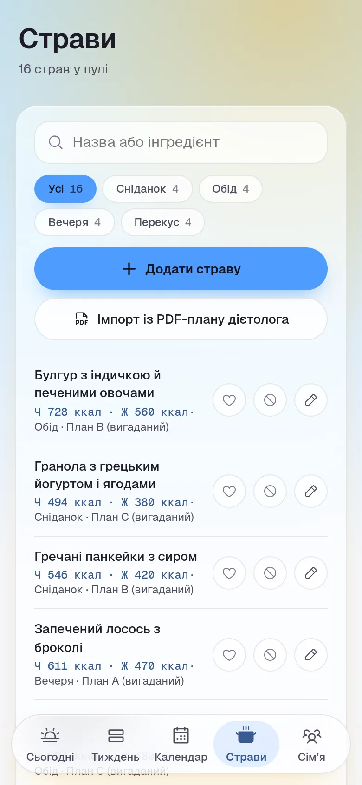
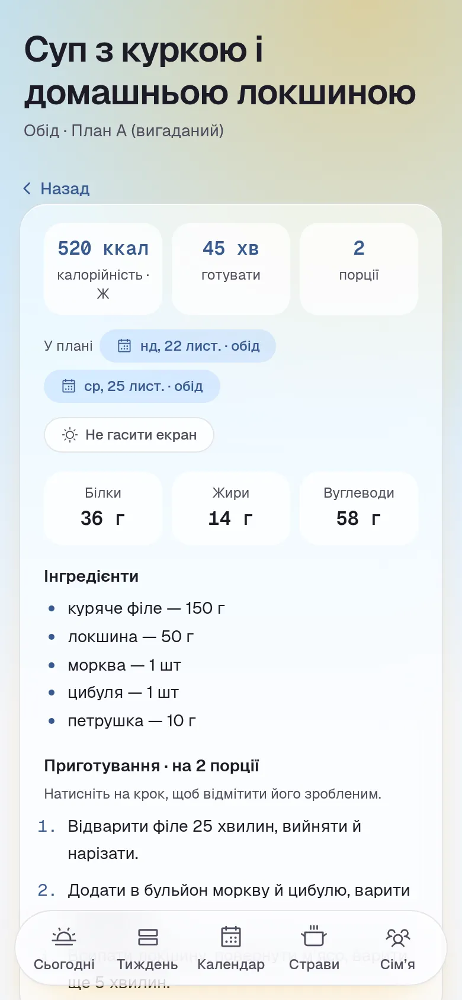
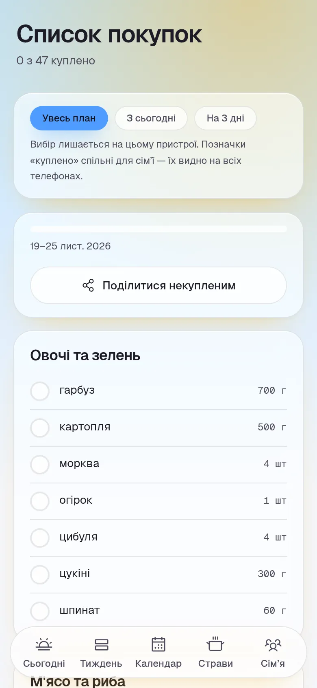
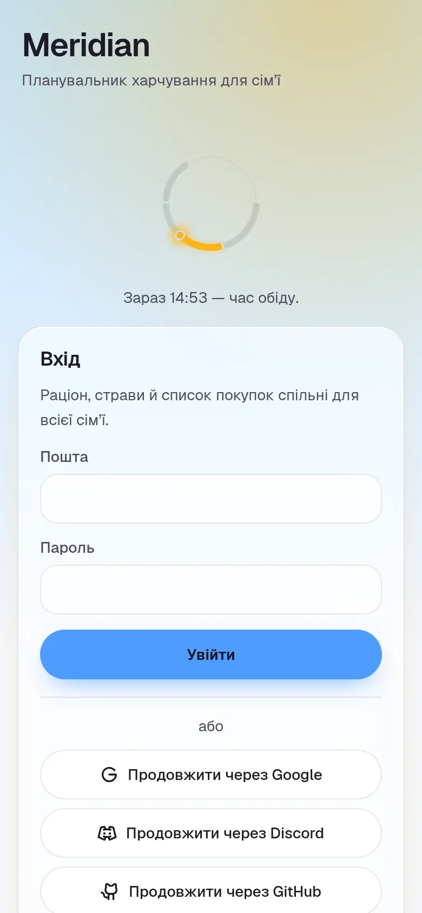
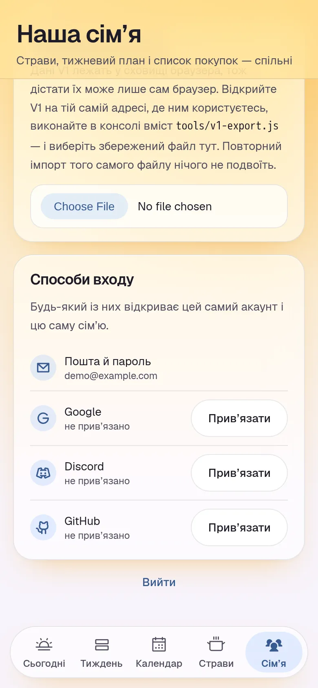

<div align="center">

# Meridian

**Планувальник харчування для сім'ї, що сам збирає тиждень із планів дієтолога.**

[](https://github.com/1h8sn0w/meridian/actions/workflows/ci.yml)




[In English](README.en.md)

</div>

---

Дієтолог дає кілька планів харчування в PDF. Meridian розкладає їх на окремі страви й сам збирає новий тиждень: тримає калорійність і структуру плану, але міксує страви з кількох планів, щоб раціон не набридав. Головний екран відповідає на одне питання: що їсти зараз.

Для сімей, які харчуються за планом дієтолога й хочуть різноманіття без підрахунків. Застосунок нічого не вигадує: кожна страва — з плану, PDF-імпорту або вашого ручного вводу.

## Можливості

- **Тиждень однією кнопкою.** Генератор добирає страву в кожен слот так, щоб день тримався в коридорі цілі профілю (типово ±100 ккал), страви не повторювались частіше за правило антиповтору, а тиждень спирався на кілька планів.
- **«Сьогодні».** Годинник дня з вікнами прийомів, поточна страва з БЖВ та інгредієнтами, нагадування перед прийомами. Календар показує план і БЖВ за будь-який день.
- **Страви й рецепти.** Спільний пул страв: пошук, «улюблене» і «не подобається», ручне додавання, імпорт із PDF-плану, стартовий набір від адміністратора сервера.
- **Список покупок** на тиждень за відділами магазину; позначки «куплено» спільні для всієї сім'ї.
- **Сім'я.** Спільні раціон, пул і покупки; у кожного профілю своя ціль калорій і порція; нові члени приєднуються кодом запрошення.
- **Local-first PWA.** Встановлюється з браузера, працює без мережі й синхронізує пристрої сім'ї.
- **Інтерфейс** українською, англійською, польською й німецькою. **Вхід** — поштою з паролем або через Google, Discord, GitHub.

<div align="center">






Знімки — з тестового акаунта з вигаданими стравами.

</div>

## Де спробувати

Зараз Meridian — self-host: свій сервер піднімається однією командою (нижче). Хостована версія буде згодом; її адреса — **TODO: домен ще не куплено**.

## Self-host

### Вимоги

- Docker із плагіном Compose (`docker compose`, не старий `docker-compose`). Перевірено на Docker 27 і Compose 5.6.
- Пам'ять: у простої стек займає близько 0,5 ГБ RAM, під навантаженням синхронізації — більше; закладайте 1–2 ГБ. Диск: кілька ГБ під образи (лише Postgres — 1,2 ГБ).
- Вільні порти 80 і 443 або свої через `HTTP_PORT`/`HTTPS_PORT`.
- HTTPS для будь-якої адреси, крім `localhost`: без захищеного контексту браузер не дасть застосунку відкрити локальну базу. Для доступу з інтернету — домен, що вказує на цей хост.

### Перший запуск

```sh
git clone https://github.com/1h8sn0w/meridian.git
cd meridian
docker compose up -d
```

Перший запуск триває кілька хвилин: збирається образ застосунку. Секрети (пароль Postgres, `JWT_SECRET`, anon-ключ) стек генерує сам і тримає у власному томі, схему бази накочує сам. `docker compose ps -a`: `init` і `migrate` у стані `Exited (0)` — так і має бути.

Далі відкрити <http://localhost>, зареєструватися, створити сім'ю й профіль, додати страви (вручну, з PDF або стартовим набором) і на екрані «Тиждень» натиснути «Згенерувати тиждень».

### Змінні оточення

`.env` потрібен лише тоді, коли щось змінюєте: `cp .env.example .env`. Після зміни — `docker compose up -d`. Секрети стека в `.env` не потрапляють; там будуть лише ключі OAuth, якщо ввімкнете вхід через провайдерів.

| Змінна | Типово | Що робить |
|--------|--------|-----------|
| `APP_URL` | `http://localhost` | Адреса застосунку. `https://` з доменом вмикає сертифікат Let's Encrypt |
| `HTTP_PORT`, `HTTPS_PORT` | `80`, `443` | Порти хоста; порт в `APP_URL` має збігатися з одним із них |
| `GOTRUE_DISABLE_SIGNUP` | `false` | `true` закриває реєстрацію (див. «Безпека») |
| `GOTRUE_MAILER_AUTOCONFIRM` | `true` | Пошти в стеку немає, тож акаунт підтверджується одразу |
| `GOTRUE_EXTERNAL_<ПРОВАЙДЕР>_*` | вимкнено | Вхід через Google, Discord, GitHub (нижче) |
| `STARTER_SET_FILE` | порожньо | JSON стартового набору страв, поза репозиторієм |
| `WEB_IMAGE` | порожньо | Готовий образ застосунку замість збірки; працює лише з накладкою: `docker compose -f compose.yaml -f infra/compose.prebuilt.yaml up -d` |

Домашній сервер без домену (`https://<IP>:<порт>` і локальний центр сертифікації), стартовий набір і готовий образ описано в [`infra/README.md`](infra/README.md).

### Оновлення

Спершу зробіть бекап (нижче), потім:

```sh
git pull
docker compose up -d --build
```

`--build` перезбирає образ застосунку з нових вихідників: без нього Compose лишить старий. Нові міграції бази `migrate` накотить сам. З готовим образом замість `--build` спершу підтягніть новий: `docker compose -f compose.yaml -f infra/compose.prebuilt.yaml pull caddy`, далі `up -d` з тими самими `-f`.

### Бекап і відновлення

Усе, що треба зберегти, лежить у томах Docker: `db-data` (база), `secrets` (паролі й ключі — без них база з бекапу не відкриється), `db-config` і `caddy-data` (сертифікати). Бекап — архів цих томів при зупиненому стеку. Команди виконуються з теки репозиторію, а архів лягає поруч із нею, щоб випадково не потрапити в git:

```sh
VOLS="-v meridian_secrets:/v/secrets -v meridian_db-data:/v/db-data -v meridian_db-config:/v/db-config -v meridian_caddy-data:/v/caddy-data"
docker compose stop
docker run --rm $VOLS -v "$PWD/..":/backup alpine tar czf /backup/meridian-backup.tgz -C /v .
docker compose up -d
```

Відновлення — на чистому хості (клон репозиторію і той самий `.env`) або після `docker compose down -v`:

```sh
VOLS="-v meridian_secrets:/v/secrets -v meridian_db-data:/v/db-data -v meridian_db-config:/v/db-config -v meridian_caddy-data:/v/caddy-data"
docker compose create
docker run --rm $VOLS -v "$PWD/..":/backup alpine tar xzf /backup/meridian-backup.tgz -C /v
docker compose up -d
```

Архів містить секрети стека, тож зберігайте його так само, як паролі. Префікс `meridian_` — ім'я проєкту з `compose.yaml`; якщо запускаєте з `-p` чи `COMPOSE_PROJECT_NAME`, підставте своє. З готовим образом `create` і `up -d` запускайте з тими самими `-f`, що й при оновленні.

## Вхід через Google, Discord і GitHub

Типово вимкнено: на екрані входу лише пошта й пароль. Кожна установка реєструє власний OAuth-застосунок у провайдера:

| Провайдер | Де створити | Куди вписати callback URL |
|-----------|-------------|---------------------------|
| Google | Google Cloud Console → APIs & Services → Credentials → Create credentials → OAuth client ID, тип «Web application» | Authorized redirect URIs |
| Discord | Developer Portal → Applications → New Application → OAuth2 | Redirects |
| GitHub | Settings → Developer settings → OAuth Apps → New OAuth App | Authorization callback URL |

Callback URL — `APP_URL` + `/auth/v1/callback`, наприклад `https://meridian.example.com/auth/v1/callback`. Google не приймає адресу з IP, тож для нього потрібен домен. Потім у `.env` (так само `GOOGLE` і `DISCORD`):

```
GOTRUE_EXTERNAL_GITHUB_ENABLED=true
GOTRUE_EXTERNAL_GITHUB_CLIENT_ID=<Client ID>
GOTRUE_EXTERNAL_GITHUB_SECRET=<Client secret>
```

і `docker compose up -d auth`. Кнопка «Продовжити через …» з'явиться на екрані входу сама.

**Прив'язка до наявного акаунта.** «Сім'я» → «Способи входу» → «Прив'язати»: далі будь-який прив'язаний спосіб відкриває той самий акаунт і ту саму сім'ю. Автоматичної прив'язки за поштою свідомо немає, тому перший вхід через провайдера без прив'язки створює **новий** акаунт, навіть з тією самою поштою. Спершу увійдіть звичним способом і прив'яжіть провайдера. Відв'язати можна все, крім пошти й останнього способу входу. Конфлікти й деталі — у [`.env.example`](.env.example).

<div align="center">




</div>

## Безпека

**Знайшли вразливість** — не відкривайте публічне issue. Повідомте приватно через GitHub: вкладка **Security** → **Report a vulnerability**.

Для власного сервера:

- **Закрийте реєстрацію**, щойно заведете акаунти всієї сім'ї: `GOTRUE_DISABLE_SIGNUP=true` у `.env` і `docker compose up -d auth`. Інакше зареєструватися може будь-хто, хто знає адресу. Як перевірити й як потім додати нового члена сім'ї — в [`infra/README.md`](infra/README.md).
- **Обмежте частоту запитів** до `/auth/v1/` на проксі чи тунелі перед стеком (правила rate limiting, fail2ban), щоб ускладнити перебір паролів.
- Назовні публікується лише Caddy: не відкривайте порт Postgres.
- Оновлюйтеся регулярно, а архів бекапу зберігайте зашифрованим: у ньому ключі стека.

## Як це влаштовано

Інтерфейс читає й пише SQLite на пристрої, тож жодна дія не чекає на мережу. PowerSync фоном синхронізує її з Postgres, а записи йдуть через PostgREST (last-write-wins на рівні рядка). Сервер — підмножина self-host Supabase (Postgres, GoTrue, PostgREST) за Caddy в одному `compose.yaml`; окремого сервера застосунку немає. Фронтенд — статичний SPA на Vite і TanStack Router. Генератор тижня — чистий TypeScript у [`packages/core`](packages/core): задача з обмеженнями, розв'язана жадібно з випадковістю й обмеженим бектрекінгом, без ML.

## Розробка

```sh
pnpm install
pnpm dev        # apps/web на http://localhost:3000, поруч із піднятим стеком
pnpm lint && pnpm typecheck && pnpm test && pnpm format:check && pnpm build
```

`pnpm dev` бере базу, вхід і синхронізацію з піднятого поруч стека, тож спершу йому потрібен `apps/web/.env` — команда, що його збирає, є в [`infra/README.md`](infra/README.md#розробка-застосунку).

## Документація

Кожна тека пояснює свої рішення у власному `README.md`: [`infra`](infra/README.md) — self-host і секрети ([`DECISIONS.md`](infra/DECISIONS.md) — рішення стека), [`packages/core`](packages/core/README.md) — генератор і формат стартового набору, [`packages/db`](packages/db/README.md) — таблиці й RLS, [`apps/web`](apps/web/README.md) — застосунок і PWA. Терміни — у [`GLOSSARY.md`](GLOSSARY.md), карта для AI-агентів — у [`AGENTS.md`](AGENTS.md). Задачі й архітектурні рішення живуть у Linear.

## Ліцензія

[MIT](LICENSE) © 2026 Volodymyr Chornous
